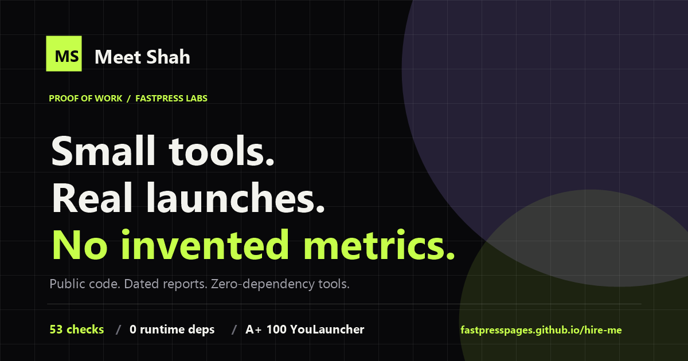

<div align="center">

# Meet Shah — proof of work

**Small tools. Real launches. No invented metrics.**

A zero-build, single-page portfolio for the builder behind [FastPress Labs](https://github.com/fastpresspages) and [LaunchGrade](https://fastpresspages.github.io/launchgrade/).

[](https://fastpresspages.github.io/hire-me/)
[](index.html)
[](styles.css)
[](app.js)
[](#stack)
[](#stack)
[](AGENTS.md)
[](samples/hire-me/report.html)
[](LICENSE)

[Live page](https://fastpresspages.github.io/hire-me/) · [LaunchGrade](https://fastpresspages.github.io/launchgrade/) · [FastPress Labs](https://github.com/fastpresspages) · [Email](mailto:meetcode99@gmail.com)

</div>



## Why this exists

Most engineering portfolios are a list of adjectives. This one is a list of receipts: public source, passing tests, dated audit reports, and the before/after of a real rebuild. It is also a deliberate demonstration of the thing it describes — a fast static page with technical SEO, accessible markup, honest copy and agent-readable files.

It is **not** a padded résumé. There are no invented employers, education, years of experience, client logos or revenue numbers. Location and work-authorization details are available on request, not guessed at.

## What is on the page

- **Selected work** — LaunchGrade, YouLauncher and FastPress Labs, each linked to public code or a dated report.
- **Skills with evidence** — product engineering, developer experience, web quality, writing and design.
- **How I work** — ship small, measure don't invent, write the docs, leave a receipt.
- **Availability** — freelance launch audits/build sprints, open-source collaboration, and full-time product engineering, founding engineer or developer-experience roles.
- **Contact** — a short brief form (FormSubmit) and a direct email link.

## Stack

Plain HTML, CSS and JavaScript. No framework, bundler, package manager or runtime dependency. Google Fonts for type; FormSubmit for the contact form; GitHub Pages for hosting.

```
index.html      page, metadata, JSON-LD
styles.css      all styling, responsive down to 360px
app.js          nav, copy email, form validation and delivery
privacy.html    plain-language privacy page
terms.html      plain-language terms
og.png          1200x630 social card
llms.txt        agent-readable summary
AGENTS.md       instructions for coding agents
```

## Run locally

```bash
python -m http.server 4182
# http://127.0.0.1:4182/
```

The contact form refuses to send from `file://`; use the local server or the live HTTPS page.

## Audit it

```bash
npx -p github:fastpresspages/launchgrade launchgrade https://fastpresspages.github.io/hire-me/
```

The scan is public and repeatable: [A+ 100/100, dated 24 October 2026](samples/hire-me/report.html), with one deliberate warning (no analytics). If it drops below an A, open an issue with the report.

## Editing availability

Availability lives in three places and they must agree:

1. The `#availability` section and `seeks` field in `index.html`.
2. The availability line in `llms.txt`.
3. The Person JSON-LD `seeks` description in `index.html`.

Change all three when the answer changes. Do not add a location, visa status or salary expectation without a direct confirmation from Meet.

## Deploy

Push to `main`. `.github/workflows/pages.yml` deploys the repo root to GitHub Pages. Enable Pages with **Settings → Pages → Source: GitHub Actions** on the first run.

## License

Code is Apache-2.0. The copy, brand and images are not licensed for reuse. See [LICENSE](LICENSE) and [terms.html](terms.html).

---

Built by [Meet Shah](https://github.com/Meet6338-X) · [FastPress Labs](https://github.com/fastpresspages) · no cookies, no analytics, no fake metrics.
